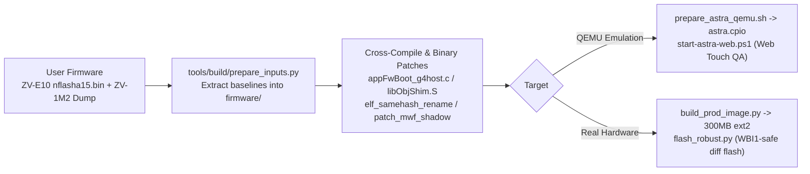

# ZV-E10 ASTRA Port

**English** | [简体中文](README.md) | [繁體中文](README.zh-TW.md) | [日本語](README.ja.md)

> Engineering toolchain, QEMU emulation environment, build/patching scripts, porting methodology, and AI Agent Skills for cross-generation porting of the **Sony ZV-1M2 (Gen 5 ASTRA)** touch menu UI and full interaction system onto the **Sony ZV-E10 (Gen 4)**.

<p>
  
  <a href="LICENSE"></a>
  <a href="https://github.com/nolan2628/ZVE10-Astra-Public/stargazers"></a>
  <a href="https://github.com/nolan2628/ZVE10-Astra-Public/issues"></a>
  <a href="https://discord.gg/wdF3y3xCYR"></a>
  <a href="#sponsor"></a>
</p>

> [!CAUTION]
> **Developers Only · Do NOT Flash by End Users (Anti-Brick Warning)**
> This project is an experimental engineering research effort **intended strictly for developers** experienced in embedded Linux, ARM reverse engineering, Fastboot/UART hardware debugging, and brick recovery. **End users are strictly prohibited from building or flashing firmware onto physical cameras**, as mismatched partition baselines, unreset fuse counters, or accidental writes to the `WBI1` sector can hard-brick the device.

> [!WARNING]
> **Copyright, Disclaimers & Current Limitations (Must Read)**
> 1. **Zero Proprietary Firmware Distribution**: This repository **does NOT contain** any Sony proprietary firmware, partition dumps, shared libraries, or UI assets (`appFw.so`, `libObj.so`, `nflasha15.bin`, etc.). Reproducers must extract required baseline files from their own legally owned devices or official firmware packages into the local `firmware/` directory (ignored by `.gitignore`).
> 2. **Bundled Non-Sony Payloads**: The repository only includes non-Sony low-level flashing helpers (`tools/flash/stage2.bin`, `tools/flash/stage2_turbo_cmd25.bin`, `tools/flash/hardware/fastboot_zve10.bin`) and open-source `pmca` components (see [THIRD_PARTY_NOTICES.md](THIRD_PARTY_NOTICES.md)).
> 3. **Known Unimplemented Capabilities (FL/VV Creative Looks & Custom LUTs)**:
>    - **Creative Looks / Filters (`FL`, `VV`, etc.)**: The underlying look tables and rendering pipeline are not yet wired up. You must extract and bridge them from other supported camera models yourself (see [751K/sony-look-bridge](https://github.com/751K/sony-look-bridge)).
>    - **Custom User LUTs**: Custom LUT support requires training/generating LUTs using the custom LUT pipeline from [Erlla/sony-a7m4-custom-firmware](https://github.com/Erlla/sony-a7m4-custom-firmware).
> 4. **Mandatory Pre-Flash Backup**: Always back up your camera's stock `nflasha15.bin` and `nflasha5.bin` before any write operation, and strictly obey the `0x2C000` (`WBI1`) sector protection rules.

---

## Showcase (Real Hardware & QEMU Emulation)

| Shooting Main UI (Gen 5 Touch OSD) | New Vertical Grouped Menu | Creative Look `FL` UI (UI only; see limitations) |
| :---: | :---: | :---: |
|  |  |  |

**QEMU (`-M zve10`) Web UI Emulation & Touch Interaction Screencast:**


---

## Core Capabilities

- **Cross-Generation Runtime Shim (`src/appFwBoot_g4host.c`)**:
  - Dedicated **16 MB thread stack** for loading `appFw.so`, avoiding default-stack overflow and 32-bit VMA exhaustion caused by 2,730 `.init_array` global constructors (up to 3.28 MB single frame).
  - **Same-Length GNU Hash Symbol Isolation** (`tools/build/elf_samehash_rename.py` + `manifests/rename_plan.json`): Renames 557 colliding symbols between Gen 4 and Gen 5 to eliminate vtable mismatch crashes (`fault=0x234`).
  - **Gen 4 Hardware Chassis Reuse & Handoff**: Preserves Gen 4 `im.elf`, `libObj.so`, `libInfraSKD.so` (plaintext), `libInfraLensCommunicator.so`, and `/sabin/`, enabling E-mount lens communication, native touch (`0x026c`), and hardware GLES handoff via `libMWF.so` shadow inheritance and `g4_handoff_real_device`.
- **QEMU Software Rasterizer & Web Touch Console (`tools/qemu/`)**:
  - Runs the full ZV-1M2 menu inside QEMU `-M zve10` without real camera hardware, syncing **640×480 Morton Z-order RGBA4444** VRAM.
  - Provides a browser-based interactive canvas (`astra_web_qemu.py` + `astra_web_ui.html`) supporting pointer click/drag touch, tactile keys, cold-boot mode routing (`menu` / `shooting` / `normal`), and live serial logs.
- **USB Sandbox Pre-check, Differential Flashing & Recovery (`tools/flash/`)**:
  - `camtool` (Jiritsu/MSC) online diagnostics and zero-flash `/log/g5/` closure verification.
  - `flash_robust.py` with chunked resume, fast `--diff-from` differential flashing, and hard lockouts protecting sector `0x2C000` (`WBI1`).
  - `restore_factory_pure.py` and `restore_wbi_auto.py` for full factory rollback and `WBI1` no-LED recovery.
- **AI Agent Skills (`.agents/skills/`)**:
  - Includes 4 standardized skills for Antigravity / Claude Code / Codex covering project routing, QEMU debugging, hardware flashing, and cross-generation RE methodology.

---

## Architecture Overview



See [docs/architecture.md](docs/architecture.md) for all 4 detailed architecture diagrams and [docs/methodology.md](docs/methodology.md) for the four engineering axioms.

---

## Prerequisites & Upstream Repositories

| Resource / Component | Source / Description | Local Path / Env Convention |
| :--- | :--- | :--- |
| **ZV-E10 2.03 Firmware Update** | [Sony Official Downloads](https://www.sony.com/electronics/support/e-mount-body-zv-e-series/zv-e10/downloads) | `Update_ZVE10V203.dmg` |
| **Sony Linux Kernel Source** | [linux-kernel.tar.gz](https://prodgpl.blob.core.windows.net/download/DI/ZV-E10_Ver.2.02/linux-kernel.tar.gz) | `work/linux-kernel.tar.gz` |
| **QEMU 11.1.2 Source** | [qemu-11.1.2.tar.xz](https://download.qemu.org/qemu-11.1.2.tar.xz) | `work/qemu-11.1.2.tar.xz` |
| **ARM Cross Toolchain** | [Bootlin armv7-eabihf, 2020.08-1](https://toolchains.bootlin.com/downloads/releases/toolchains/armv7-eabihf/tarballs/armv7-eabihf--glibc--stable-2020.08-1.tar.bz2) | `work/armv7-toolchain.tar.bz2` |
| **Prerequisite Research Repos** | [chocotan/zve10-qemu](https://github.com/chocotan/zve10-qemu)<br>[chocotan/a7c2-qemu](https://github.com/chocotan/a7c2-qemu)<br>[DavidBuchanan314/ILCE-7M4-RE](https://github.com/DavidBuchanan314/ILCE-7M4-RE)<br>[erlla/sony-a7m4-custom-firmware](https://github.com/erlla/sony-a7m4-custom-firmware)<br>[751K/sony-look-bridge](https://github.com/751K/sony-look-bridge) | QEMU `-M zve10` machine model, firmware unpacking, custom LUT training, and Creative Look (`FL`/`VV`) bridging |
| **USB & Camtool Suite** | [nolan2628/Sony-ZVE-10-Camtool](https://github.com/nolan2628/Sony-ZVE-10-Camtool) | Upstream ZV-E10 USB Jiritsu/MSC debugging & patching toolkit (bundled in `tools/flash/camtool/`) |
| **Fastboot & Flashing Toolkit** | [dino2048/zv-e10-toolkit](https://github.com/dino2048/zv-e10-toolkit) | Upstream Fastboot architecture for Sony Alpha cameras: `stage1.bin` + `stage2-flash.bin` 1 MiB Sparse flashing, Darwin `0x16` watchdog immunity keepalive, and native Windows `libusb-package` backend (bundled in `tools/flash/toolkit_fastboot/`) |
| **Python & Zig Toolchain** | [`uv`](https://docs.astral.sh/uv/) (auto-fetches `ziglang`, `pyelftools`, `pyusb`, etc.) | Host `uv` + WSL2 (for `e2fsck`/`debugfs`/QEMU) |

---

## Quickstart (Reproduction Workflow)

### Step 1: Prepare Firmware Inputs

Extract your legal backups/firmware according to [docs/firmware-extraction.md](docs/firmware-extraction.md), then run:

```powershell
uv run python tools/build/prepare_inputs.py `
  --gen4-image firmware/backup/nflasha15.bin `
  --gen5-root <path_to_unpacked_ZV1M2>
```

### Step 2: Build Patched Libraries & Cross-Gen Bootloader

```powershell
# 1. Gen 4 host preprocessing (im.elf relay patch + libMWF shadow + libIMDB trim)
uv run python tools/build/patch_im_elf.py
uv run python tools/build/patch_mwf_shadow.py
uv run python tools/build/patch_libobj.py
uv run python tools/build/generate_hybrid_imdb.py --variant dump

# 2. Gen 5 SONAME rewrite & same-hash symbol renaming
uv run python tools/build/p2_patch_soname.py
uv run python tools/build/batch_rename_g5.py

# 3. Cross-compile stub & bootloader shim (e_flags=0x05000002, GLIBC<=2.4)
uv run --with ziglang python tools/build/build_libobjshim.py
uv run --with ziglang --with pyelftools python tools/build/build_appfwboot.py --target all
```

### Step 3A: Verify Menu & Touch in QEMU Web UI

Ensure `-M zve10` QEMU, kernel `Image`, and baseline `initramfs-ui` are set up per [docs/qemu-prerequisites.md](docs/qemu-prerequisites.md) (defaults to `~/zve10-qemu/work`, overridable via `ZVE10_QEMU_WORK`):

```powershell
wsl -e bash tools/qemu/prepare_astra_qemu.sh
.\tools\qemu\start-astra-web.ps1 -Port 8765 -OpenBrowser
```

### Step 3B: Build Production Image & Flash Safely (Developers Only)

Read [docs/hardware-flashing-and-recovery.md](docs/hardware-flashing-and-recovery.md) carefully first:

```powershell
uv run python tools/build/build_prod_image.py --output build_out/nflasha15_astra_prod.bin
uv run python tools/build/verify_prod_image.py --image build_out/nflasha15_astra_prod.bin

uv run python tools/flash/check_image.py
uv run python tools/flash/flash_robust.py `
  --image build_out/nflasha15_astra_prod.bin `
  --diff-from firmware/backup/nflasha15.bin `
  --flash
```

---

## Documentation & AI Skills Index

- **Technical Guides** *(currently in Chinese)*:
  - [docs/architecture.md](docs/architecture.md) — 4 Mermaid architecture diagrams & file map
  - [docs/methodology.md](docs/methodology.md) — 4 engineering axioms & porting methodology
  - [docs/firmware-extraction.md](docs/firmware-extraction.md) — Firmware extraction & baseline verification
  - [docs/qemu-prerequisites.md](docs/qemu-prerequisites.md) — QEMU `-M zve10` & kernel setup
  - [docs/hardware-flashing-and-recovery.md](docs/hardware-flashing-and-recovery.md) — Hardware injection, USB sandbox, diff flashing & brick recovery
- **Built-in Project Skills (`.agents/skills/`)**:
  - [`zve10-astra-overview`](.agents/skills/zve10-astra-overview/SKILL.md)
  - [`zve10-astra-qemu`](.agents/skills/zve10-astra-qemu/SKILL.md)
  - [`zve10-astra-porting`](.agents/skills/zve10-astra-porting/SKILL.md)
  - [`zve10-astra-methodology`](.agents/skills/zve10-astra-methodology/SKILL.md)

---

## Community

Developers interested in Sony camera reverse engineering, QEMU emulation, and cross-generation porting are welcome to join our Discord server (**Note: technical discussion for developers only; no one-click flash bundles or flashing services are provided — please read the safety rules above before joining**):

<p>
  <a href="https://discord.gg/wdF3y3xCYR"></a>
</p>

---

## Sponsor

If this project helps your research in Sony camera reverse engineering or cross-generation firmware porting, feel free to support ongoing R&D, hardware wear, and **AI token costs** via WeChat Pay or Alipay:

| WeChat Pay | Alipay |
| :---: | :---: |
|  |  |

---

## License

This repository (including all code, scripts, and original documentation) is licensed under the **[GNU General Public License v3.0 (GPLv3)](LICENSE)**. Any use, modification, or redistribution of code from this project must preserve copyright and source attribution (see [CITATION.cff](CITATION.cff)) and license derivative works under GPLv3. See [THIRD_PARTY_NOTICES.md](THIRD_PARTY_NOTICES.md) for third-party attributions.
