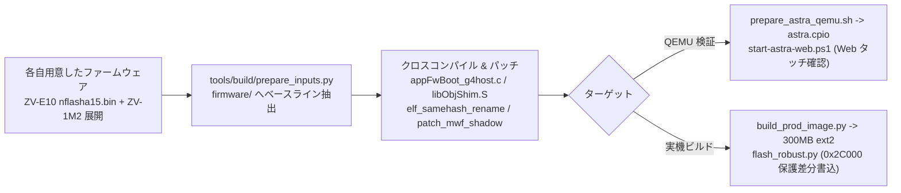

# ZV-E10 ASTRA Port

[English](README.en.md) | [简体中文](README.md) | [繁體中文](README.zh-TW.md) | **日本語**

> **Sony ZV-1M2（Gen 5 ASTRA）** の新タッチメニュー UI とフル操作系を **Sony ZV-E10（Gen 4）** へ世代を超えて移植するためのエンジニアリング・ツールチェーン、QEMU エミュレーション環境、ビルド／パッチスクリプト、開発手法、および AI Agent Skills です。

<p>
  
  <a href="LICENSE"></a>
  <a href="https://github.com/nolan2628/ZVE10-Astra-Public/stargazers"></a>
  <a href="https://github.com/nolan2628/ZVE10-Astra-Public/issues"></a>
  <a href="https://discord.gg/wdF3y3xCYR"></a>
  <a href="#スポンサー--sponsor"></a>
</p>

> [!CAUTION]
> **開発者専用 · 一般ユーザーの実機フラッシュ厳禁（文鎮化防止の警告）**
> 本プロジェクトは現在実験的な研究開発段階にあり、**組み込み Linux、ARM リバースエンジニアリング、Fastboot/UART ハードウェアデバッグ、および復旧（文鎮復旧）の知識を持つ開発者のみを対象としています**。**一般ユーザーによるビルドや実機へのファームウェア書き込みは厳禁です**。パーティション基準の不一致、ヒューズカウンタの未リセット、`WBI1` セクタへの誤書き込みにより、カメラが起動不能（文鎮化）になる恐れがあります。

> [!WARNING]
> **著作権・免責事項・現在の機能制限について（必読）**
> 1. **独自ファームウェアの非同梱**：本リポジトリにはソニー独自のファームウェア、パーティションダンプ、共有ライブラリ、UI アセット（`appFw.so`、`libObj.so`、`nflasha15.bin` など）は**一切含まれていません**。再現にあたっては、ご自身が正当に所有する実機または公式アップデートパッケージから必要なベースラインファイルをローカルの `firmware/` ディレクトリ（`.gitignore` 対象）へ抽出してください。
> 2. **同梱されている非ソニー製ペイロード**：リポジトリに含まれるバイナリは、非ソニー製の低レベル書き込み補助ペイロード（`tools/flash/stage2.bin`、`tools/flash/stage2_turbo_cmd25.bin`、`tools/flash/hardware/fastboot_zve10.bin`）および OSS の `pmca` コンポーネントのみです（詳細は [THIRD_PARTY_NOTICES.md](THIRD_PARTY_NOTICES.md) を参照）。
> 3. **未対応機能（FL / VV クリエイティブルックおよびカスタム LUT）**：
>    - **クリエイティブルック / フィルター（`FL`、`VV` など）**：現在、下層のパラメータテーブルおよびパイプラインは未接続です。対応機種からご自身で抽出・ブリッジする必要があります（参考：[751K/sony-look-bridge](https://github.com/751K/sony-look-bridge)）。
>    - **カスタム LUT**：ユーザー LUT を使用する場合は、[Erlla/sony-a7m4-custom-firmware](https://github.com/Erlla/sony-a7m4-custom-firmware) のカスタム LUT 方式を用いて学習・生成を行う必要があります。
> 4. **書き込み前の必須バックアップ**：実機への書き込みを行う前に、必ず純正の `nflasha15.bin` と `nflasha5.bin` を完全にバックアップし、`0x2C000`（`WBI1`）セクタ保護ルールを厳守してください。

---

## デモ・成果（実機動作 & QEMU エミュレーション）

| 撮影メイン画面（Gen 5 タッチ OSD） | 新しい縦型グループメニュー | クリエイティブルック `FL` 画面（UI のみ・上記制限参照） |
| :---: | :---: | :---: |
|  |  |  |

**QEMU (`-M zve10`) Web UI エミュレーションおよびタッチ操作録画：**


---

## 主な機能

- **世代間ランタイムシム（`src/appFwBoot_g4host.c`）**：
  - `appFw.so` の 2,730 個の `.init_array` コンストラクタ（単一フレーム最大 3.28 MB）によるデフォルトスタック溢れと 32-bit VMA 枯渇を防ぐため、**専用の 16 MB スレッドスタック**でロードを実行。
  - **同長・同一 GNU Hash シンボル隔離**（`tools/build/elf_samehash_rename.py` + `manifests/rename_plan.json`）：Gen 4 と Gen 5 間で衝突する 557 個のシンボルを改名し、仮想テーブル不整合クラッシュ（`fault=0x234`）を根絶。
  - **Gen 4 ハードウェア基盤の再利用と引き継ぎ**：Gen 4 の `im.elf`、`libObj.so`、`libInfraSKD.so`（平文）、`libInfraLensCommunicator.so`、`/sabin/` を保持し、`libMWF.so` シャドウ継承パッチと `g4_handoff_real_device` により E マウントレンズ通信、ネイティブタッチ（`0x026c`）、ハードウェア GLES をシームレスに引き継ぎ。
- **QEMU ソフトウェアラスタライザ & Web タッチコンソール（`tools/qemu/`）**：
  - 実機なしで QEMU `-M zve10` 上に ZV-1M2 メニュー一式を起動し、**640×480 Morton Z-order RGBA4444** VRAM を同期出力。
  - ブラウザ上の対話キャンバス（`astra_web_qemu.py` + `astra_web_ui.html`）でクリック／ドラッグ操作、物理キー送信、起動モード指定（`menu` / `shooting` / `normal`）、シリアルログ監視が可能。
- **実機 USB サンドボックス検証・差分フラッシュ・復旧（`tools/flash/`）**：
  - `camtool`（Jiritsu/MSC）によるオンライン診断と `/log/g5/` 上での非破壊クローズ検証。
  - レジューム機能・高速 `--diff-from` 差分書き込み・`0x2C000` (`WBI1`) セクタ保護ロックを備えた `flash_robust.py`。
  - 工場出荷状態への完全復元（`restore_factory_pure.py`）および `WBI1` 復旧ツール（`restore_wbi_auto.py`）。
- **AI エージェント Skills（`.agents/skills/`）**：
  - Antigravity / Claude Code / Codex 向けに、プロジェクト案内・QEMU デバッグ・実機フラッシュ・世代間 RE 手法を網羅した 4 つの標準 Skill を同梱。

---

## アーキテクチャ概要



詳細な 4 枚のアーキテクチャ図は [docs/architecture.md](docs/architecture.md)、4 つの設計公理は [docs/methodology.md](docs/methodology.md) を参照してください。

---

## 前提環境とアップストリーム・リポジトリ

| リソース / コンポーネント | 入手元 / 説明 | 配置先 / 環境変数 |
| :--- | :--- | :--- |
| **ZV-E10 2.03 アップデータ** | [Sony 公式ダウンロードページ](https://www.sony.com/electronics/support/e-mount-body-zv-e-series/zv-e10/downloads) | リポジトリ直下または作業フォルダ内の `Update_ZVE10V203.dmg` |
| **Sony Linux カーネルソース** | [linux-kernel.tar.gz](https://prodgpl.blob.core.windows.net/download/DI/ZV-E10_Ver.2.02/linux-kernel.tar.gz) | `work/linux-kernel.tar.gz` |
| **QEMU 11.1.2 ソース** | [qemu-11.1.2.tar.xz](https://download.qemu.org/qemu-11.1.2.tar.xz) | `work/qemu-11.1.2.tar.xz` |
| **ARM クロスツールチェーン** | [Bootlin armv7-eabihf, 2020.08-1](https://toolchains.bootlin.com/downloads/releases/toolchains/armv7-eabihf/tarballs/armv7-eabihf--glibc--stable-2020.08-1.tar.bz2) | `work/armv7-toolchain.tar.bz2` |
| **前提リサーチ・リポジトリ** | [chocotan/zve10-qemu](https://github.com/chocotan/zve10-qemu)<br>[chocotan/a7c2-qemu](https://github.com/chocotan/a7c2-qemu)<br>[DavidBuchanan314/ILCE-7M4-RE](https://github.com/DavidBuchanan314/ILCE-7M4-RE)<br>[erlla/sony-a7m4-custom-firmware](https://github.com/erlla/sony-a7m4-custom-firmware)<br>[751K/sony-look-bridge](https://github.com/751K/sony-look-bridge) | `-M zve10` QEMU マシンモデル、ファームウェア展開、カスタム LUT 学習、クリエイティブルック（`FL`/`VV`）抽出に利用 |
| **USB デバッグ / Camtool** | [nolan2628/Sony-ZVE-10-Camtool](https://github.com/nolan2628/Sony-ZVE-10-Camtool) | ZV-E10 用 USB Jiritsu/MSC オンラインデバッグ＆パッチツール（`tools/flash/camtool/` に同梱） |
| **Fastboot & ハードウェア書き込みツール** | [dino2048/zv-e10-toolkit](https://github.com/dino2048/zv-e10-toolkit) | ソニーミラーレス Fastboot プロトコルおよび書き込みアーキテクチャのアップストリーム：`stage1.bin` + `stage2-flash.bin` 1 MiB Sparse 分割フラッシュ、Darwin `0x16` ウォッチドッグ自動リセット解除、および Windows `libusb-package` ネイティブ接続（`tools/flash/toolkit_fastboot/` に同梱） |
| **Python & Zig ツールチェーン** | [`uv`](https://docs.astral.sh/uv/)（`ziglang`、`pyelftools`、`pyusb` 等を自動取得） | ホストに `uv` + WSL2（`e2fsck`/`debugfs`/QEMU 用） |

---

## クイックスタート（再現手順）

### Step 1：ファームウェア入力の準備

[docs/firmware-extraction.md](docs/firmware-extraction.md) に従って正規バックアップ／アップデートから抽出後、以下を実行します：

```powershell
uv run python tools/build/prepare_inputs.py `
  --gen4-image firmware/backup/nflasha15.bin `
  --gen5-root <展開した_ZV1M2_ルートディレクトリ>
```

### Step 2：パッチ適用と世代間ブートローダのビルド

```powershell
# 1. Gen 4 ホスト前処理（im.elf リレーパッチ + libMWF シャドウ継承 + libIMDB 整理）
uv run python tools/build/patch_im_elf.py
uv run python tools/build/patch_mwf_shadow.py
uv run python tools/build/patch_libobj.py
uv run python tools/build/generate_hybrid_imdb.py --variant dump

# 2. Gen 5 ライブラリの SONAME 書き換え & 同 Hash シンボル改名
uv run python tools/build/p2_patch_soname.py
uv run python tools/build/batch_rename_g5.py

# 3. スタブとブートローダシムのクロスコンパイル (e_flags=0x05000002, GLIBC<=2.4)
uv run --with ziglang python tools/build/build_libobjshim.py
uv run --with ziglang --with pyelftools python tools/build/build_appfwboot.py --target all
```

### Step 3A：QEMU Web UI でのメニュー・タッチ動作検証

[docs/qemu-prerequisites.md](docs/qemu-prerequisites.md) に従い `-M zve10` QEMU、カーネル `Image`、ベース `initramfs-ui` を準備してください（デフォルトは `~/zve10-qemu/work`、`ZVE10_QEMU_WORK` で変更可能）：

```powershell
wsl -e bash tools/qemu/prepare_astra_qemu.sh
.\tools\qemu\start-astra-web.ps1 -Port 8765 -OpenBrowser
```

### Step 3B：実機用イメージのビルドと安全なフラッシュ（開発者限定）

事前に [docs/hardware-flashing-and-recovery.md](docs/hardware-flashing-and-recovery.md) を必ず熟読してください：

```powershell
uv run python tools/build/build_prod_image.py --output build_out/nflasha15_astra_prod.bin
uv run python tools/build/verify_prod_image.py --image build_out/nflasha15_astra_prod.bin

uv run python tools/flash/check_image.py
uv run python tools/flash/flash_robust.py `
  --image build_out/nflasha15_astra_prod.bin `
  --diff-from firmware/backup/nflasha15.bin `
  --flash
```

---

## ドキュメント & AI Skills 索引

- **技術ドキュメント** *(現在、詳細ガイドは中国語簡体字で記述されています)*：
  - [docs/architecture.md](docs/architecture.md) —— 4 枚の Mermaid アーキテクチャ図と構成一覧
  - [docs/methodology.md](docs/methodology.md) —— 世代間移植の 4 公理と解析手法
  - [docs/firmware-extraction.md](docs/firmware-extraction.md) —— ファームウェア抽出と検証手順
  - [docs/qemu-prerequisites.md](docs/qemu-prerequisites.md) —— QEMU `-M zve10` およびカーネル構築ガイド
  - [docs/hardware-flashing-and-recovery.md](docs/hardware-flashing-and-recovery.md) —— UART 注入、USB サンドボックス、差分書込および復旧手順
- **同梱 Project Skills（`.agents/skills/`）**：
  - [`zve10-astra-overview`](.agents/skills/zve10-astra-overview/SKILL.md)
  - [`zve10-astra-qemu`](.agents/skills/zve10-astra-qemu/SKILL.md)
  - [`zve10-astra-porting`](.agents/skills/zve10-astra-porting/SKILL.md)
  - [`zve10-astra-methodology`](.agents/skills/zve10-astra-methodology/SKILL.md)

---

## 開発者コミュニティ / Community

ソニー製カメラのリバースエンジニアリング、QEMU エミュレーション、世代間移植に関心のある開発者の方は、Discord サーバーでの技術交流にぜひご参加ください（**注意：本コミュニティは開発者向けの技術議論専用です。一般向けのワンクリック導入パッケージや代行フラッシュは提供していません。参加前に上記の安全ガイドラインを必ずお読みください**）：

<p>
  <a href="https://discord.gg/wdF3y3xCYR"></a>
</p>

---

## スポンサー / Sponsor

本プロジェクトがソニー製カメラのファームウェア解析や世代間移植の研究にお役に立ちましたら、WeChat Pay または Alipay からのご支援をお待ちしております（**AI トークン費用のサポート**や検証機材・開発継続の励みになります）：

| WeChat Pay (微信支付) | Alipay (支付宝) |
| :---: | :---: |
|  |  |

---

## License

本リポジトリのすべてのコード、スクリプト、および独自ドキュメントは **[GNU General Public License v3.0 (GPLv3)](LICENSE)** の下で公開されています。本プロジェクトのコードを参照・改変・再配布する派生プロジェクトでは、著作権表示と出典の明記（[CITATION.cff](CITATION.cff) を参照）および GPLv3 に基づくソースコードの公開が必要です。サードパーティの権利表示は [THIRD_PARTY_NOTICES.md](THIRD_PARTY_NOTICES.md) をご覧ください。
