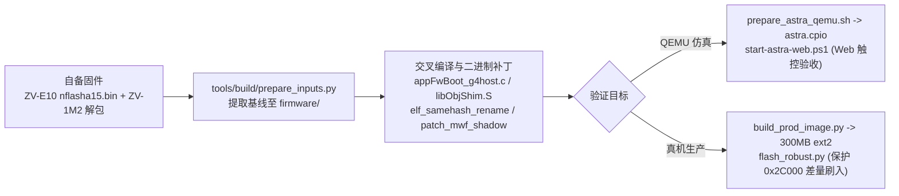

# ZV-E10 ASTRA Port

[English](README.en.md) | **简体中文** | [繁體中文](README.zh-TW.md) | [日本語](README.ja.md)

> 将 **Sony ZV-1M2（Gen 5 ASTRA）** 新版触控菜单 UI 与全交互体系跨代移植至 **Sony ZV-E10（Gen 4）** 的工程工具链、QEMU 仿真环境、构建脚本、方法论与 AI Agent Skills。

<p>
  
  <a href="LICENSE"></a>
  <a href="https://github.com/nolan2628/ZVE10-Astra-Public/stargazers"></a>
  <a href="https://github.com/nolan2628/ZVE10-Astra-Public/issues"></a>
  <a href="https://discord.gg/wdF3y3xCYR"></a>
  <a href="#赞助支持--sponsor"></a>
</p>

> [!CAUTION]
> **仅面向开发者 · 禁止普通用户刷入（防变砖警示）**
> 本项目目前处于实验性工程研发阶段，**仅面向具备嵌入式 Linux、ARM 逆向、Fastboot/UART 硬件调试及救砖能力的开发者**。**严禁普通用户直接编译或向真机刷入固件**，否则极易因分区基线不匹配、熔断计数未复位或误操作 `WBI1` 扇区导致相机无法开机（变砖）。

> [!WARNING]
> **版权、免责与当前功能边界声明（必读）**
> 1. **零专有固件分发**：本仓库**不包含**任何索尼专有固件、镜像、共享库或 UI 资源（`appFw.so`、`libObj.so`、`nflasha15.bin` 等）。复现者需自行从合法拥有的设备或官方升级包中提取所需基线文件至本地 `firmware/` 目录（已由 `.gitignore` 忽略）。
> 2. **保留载荷说明**：仓库仅额外保留非索尼的底层刷机辅助载荷（`tools/flash/stage2.bin`、`tools/flash/stage2_turbo_cmd25.bin`、`tools/flash/hardware/fastboot_zve10.bin`）及开源 `pmca` 组件（详见 [THIRD_PARTY_NOTICES.md](THIRD_PARTY_NOTICES.md)）。
> 3. **已知未打通能力（FL / VV 创意外观与自定义 LUT）**：
>    - **创意外观 / 滤镜（`FL`、`VV` 等）**：当前底层参数表与管线尚未打通，需开发者自行从其他支持机型提取适配（参考：[751K/sony-look-bridge](https://github.com/751K/sony-look-bridge)）。
>    - **自定义 LUT**：关于 User LUT 支持，需配合 [Erlla/sony-a7m4-custom-firmware](https://github.com/Erlla/sony-a7m4-custom-firmware) 的自定义 LUT 方案进行训练与生成。
> 4. **刷机前置备份**：真机任何写操作前，务必完整备份本机原厂 `nflasha15.bin` 与 `nflasha5.bin`，并严格遵守 `0x2C000` (`WBI1`) 扇区保护规程。

---

## 成果展示（真机实拍 & QEMU 仿真）

| 真机拍摄主界面（新触控 OSD） | 真机新版竖向菜单 | 真机创意外观 `FL` 菜单（仅 UI，底层见限制说明） |
| :---: | :---: | :---: |
|  |  |  |

**QEMU (`-M zve10`) Web UI 仿真与触控交互录屏：**


---

## 核心能力

- **跨代运行时垫片（`src/appFwBoot_g4host.c`）**：
  - 独立 **16MB 专属栈线程**加载 `appFw.so`，规避 2,730 个 `.init_array` 构造函数（单帧最高 3.28MB）导致的默认线程栈溢出与 32-bit VMA 耗尽。
  - **等长同 GNU Hash 符号隔离**（`tools/build/elf_samehash_rename.py` + `manifests/rename_plan.json`）：消除四代与五代 557 个冲突符号（如 `fault=0x234` 崩溃）。
  - **四代硬件底盘复用与交接**：保留四代 `im.elf`、`libObj.so`、`libInfraSKD.so`（明文）、`libInfraLensCommunicator.so` 与 `/sabin/`，通过 `libMWF.so` 影子继承补丁与 `g4_handoff_real_device` 实现 E 卡口镜头、触控（`0x026c`）与硬件显存无缝交接。
- **QEMU 软光栅仿真与 Web 触控台（`tools/qemu/`）**：
  - 支持在无真机的情况下通过 QEMU `-M zve10` 运行完整 ZV-1M2 新菜单，软光栅同步输出 **640×480 Morton Z-order RGBA4444** 显存。
  - 提供基于浏览器画布的实时 Web UI（`astra_web_qemu.py` + `astra_web_ui.html`），支持鼠标点击/拖拽触控、物理按键、冷启动模式直达（`menu` / `shooting` / `normal`）与实时串口日志监控。
- **真机 USB 沙盒预检、差量刷写与救砖（`tools/flash/`）**：
  - `camtool`（Jiritsu/MSC）在线健康检查与 `/log/g5/` 零刷机沙盒闭包验证。
  - `flash_robust.py` 支持断点续传与秒级 `--diff-from` 差量刷写，并硬件级锁定保护 `0x2C000` (`WBI1`) 扇区。
  - `restore_factory_pure.py` 与 `restore_wbi_auto.py` 提供完整出厂回退与红灯不亮救砖能力。
- **AI 协作 Skills（`.agents/skills/`）**：
  - 内置 4 套面向 Antigravity / Claude Code / Codex 的标准化 Skill，覆盖总览导航、QEMU 调试、真机刷写与跨代逆向方法论。

---

## 系统架构速览



完整 4 张详细架构图请查阅 [docs/architecture.md](docs/architecture.md)，工程原理与四大公理请查阅 [docs/methodology.md](docs/methodology.md)。

---

## 前置依赖与开源上游

| 资源 / 组件 | 来源 / 说明 | 本地放置 / 环境变量约定 |
| :--- | :--- | :--- |
| **ZV-E10 2.03 固件更新包** | [Sony 官方下载页面](https://www.sony.com/electronics/support/e-mount-body-zv-e-series/zv-e10/downloads) | 仓库根目录或工作区下的 `Update_ZVE10V203.dmg` |
| **Sony Linux 源码** | [linux-kernel.tar.gz](https://prodgpl.blob.core.windows.net/download/DI/ZV-E10_Ver.2.02/linux-kernel.tar.gz) | `work/linux-kernel.tar.gz` |
| **QEMU 11.1.2 源码** | [qemu-11.1.2.tar.xz](https://download.qemu.org/qemu-11.1.2.tar.xz) | `work/qemu-11.1.2.tar.xz` |
| **ARM 交叉工具链** | [Bootlin armv7-eabihf，2020.08-1](https://toolchains.bootlin.com/downloads/releases/toolchains/armv7-eabihf/tarballs/armv7-eabihf--glibc--stable-2020.08-1.tar.bz2) | `work/armv7-toolchain.tar.bz2` |
| **前置开源研究仓库** | [chocotan/zve10-qemu](https://github.com/chocotan/zve10-qemu)<br>[chocotan/a7c2-qemu](https://github.com/chocotan/a7c2-qemu)<br>[DavidBuchanan314/ILCE-7M4-RE](https://github.com/DavidBuchanan314/ILCE-7M4-RE)<br>[erlla/sony-a7m4-custom-firmware](https://github.com/erlla/sony-a7m4-custom-firmware)<br>[751K/sony-look-bridge](https://github.com/751K/sony-look-bridge) | 用于搭建 `-M zve10` QEMU 机器模型、固件解包、自定义 LUT 训练与创意外观（`FL`/`VV`）提取适配 |
| **USB 调试与 Camtool 工具链** | [nolan2628/Sony-ZVE-10-Camtool](https://github.com/nolan2628/Sony-ZVE-10-Camtool) | 真机 USB Jiritsu/MSC 通信、在线调试与补丁套件上游（内置于 `tools/flash/camtool/`） |
| **Fastboot 与硬件刷写工具链** | [dino2048/zv-e10-toolkit](https://github.com/dino2048/zv-e10-toolkit) | 索尼微单 Fastboot 协议与刷写架构上游：`stage1.bin` + `stage2-flash.bin` 1 MiB Sparse 分片刷写、Darwin `0x16` 硬件看门狗保活长会话，与 Windows `libusb-package` 原生直连（内置于 `tools/flash/toolkit_fastboot/`） |
| **Python & Zig 工具链** | [`uv`](https://docs.astral.sh/uv/)（自动按需拉取 `ziglang`、`pyelftools`、`pyusb` 等） | 宿主机安装 `uv` 与 WSL2（用于 `e2fsck`/`debugfs`/QEMU） |

---

## 快速开始（复现流程）

### Step 1：准备固件输入

按照 [docs/firmware-extraction.md](docs/firmware-extraction.md) 从个人备份/官方更新包提取基线后运行：

```powershell
uv run python tools/build/prepare_inputs.py `
  --gen4-image firmware/backup/nflasha15.bin `
  --gen5-root <你的_ZV1M2_解包根目录>
```

### Step 2：构建补丁库与跨代引导垫片

```powershell
# 1. 四代宿主预处理（im.elf 后台接力补丁 + libMWF 影子继承 + libIMDB 裁剪）
uv run python tools/build/patch_im_elf.py
uv run python tools/build/patch_mwf_shadow.py
uv run python tools/build/patch_libobj.py
uv run python tools/build/generate_hybrid_imdb.py --variant dump

# 2. 五代库 SONAME 改写与等长同 Hash 符号重命名
uv run python tools/build/p2_patch_soname.py
uv run python tools/build/batch_rename_g5.py

# 3. 交叉编译桩库与跨代引导垫片 (e_flags=0x05000002, GLIBC<=2.4)
uv run --with ziglang python tools/build/build_libobjshim.py
uv run --with ziglang --with pyelftools python tools/build/build_appfwboot.py --target all
```

### Step 3A：在 QEMU Web UI 中验证新菜单与触控

确保已参照 [docs/qemu-prerequisites.md](docs/qemu-prerequisites.md) 准备好 `-M zve10` QEMU、内核与基础 `initramfs-ui`（默认位于 `~/zve10-qemu/work`，可通过 `ZVE10_QEMU_WORK` 覆盖）：

```powershell
# 生成 QEMU 版 libIMDB（若具备 37,204 B 固件版）并构建 astra.cpio
wsl -e bash tools/qemu/prepare_astra_qemu.sh

# 启动网页触控交互服务
.\tools\qemu\start-astra-web.ps1 -Port 8765 -OpenBrowser
```

### Step 3B：构建真机生产镜像并安全刷入

请先阅读完整安全规程 [docs/hardware-flashing-and-recovery.md](docs/hardware-flashing-and-recovery.md)：

```powershell
# 构建并严格校验 300MB ext2 生产镜像
uv run python tools/build/build_prod_image.py --output build_out/nflasha15_astra_prod.bin
uv run python tools/build/verify_prod_image.py --image build_out/nflasha15_astra_prod.bin

# 真机当前镜像指纹判定 + 保护 0x2C000 的差量刷入
uv run python tools/flash/check_image.py
uv run python tools/flash/flash_robust.py `
  --image build_out/nflasha15_astra_prod.bin `
  --diff-from firmware/backup/nflasha15.bin `
  --flash
```

---

## 文档与 AI Skills 索引

- **架构与方法论文档**：
  - [docs/architecture.md](docs/architecture.md) —— 4 张系统架构图与核心组件映射
  - [docs/methodology.md](docs/methodology.md) —— 跨代移植四大工程公理与逆向方法论
  - [docs/firmware-extraction.md](docs/firmware-extraction.md) —— 固件提取与基线校验教程
  - [docs/qemu-prerequisites.md](docs/qemu-prerequisites.md) —— QEMU `-M zve10` 与内核搭建指南
  - [docs/hardware-flashing-and-recovery.md](docs/hardware-flashing-and-recovery.md) —— 硬件注入、USB 沙盒、差量刷机与救砖指南
- **内置 Project Skills（`.agents/skills/`）**：
  - [`zve10-astra-overview`](.agents/skills/zve10-astra-overview/SKILL.md) —— 项目总览与任务路由入口
  - [`zve10-astra-qemu`](.agents/skills/zve10-astra-qemu/SKILL.md) —— QEMU 仿真构建、软光栅与 Web 触控调试
  - [`zve10-astra-porting`](.agents/skills/zve10-astra-porting/SKILL.md) —— 真机 USB 沙盒、镜像构建、差量刷写与救砖
  - [`zve10-astra-methodology`](.agents/skills/zve10-astra-methodology/SKILL.md) —— 跨代符号隔离、栈帧分析与崩溃定位方法论

---

## 开发者交流 / Community

欢迎对索尼相机逆向、QEMU 仿真和跨代移植感兴趣的开发者加入 Discord 频道交流排查经验（**注：本群仅面向开发者技术讨论，不提供一键刷机包或代刷服务，入群前请务必阅读上方安全红线**）：

<p>
  <a href="https://discord.gg/wdF3y3xCYR"></a>
</p>

---

## 赞助支持 / Sponsor

如果本项目对你开展索尼相机固件逆向或跨代移植研究有所帮助，欢迎通过微信或支付宝扫码赞助支持——**希望多多赞助 token 费用**，用于持续推进 AI 辅助逆向分析、工程开发与设备测试开销：

| 微信支付 (WeChat Pay) | 支付宝 (Alipay) |
| :---: | :---: |
|  |  |

---

## License

本仓库中的全部代码、脚本与原创文档均采用 **[GNU General Public License v3.0 (GPLv3)](LICENSE)** 开源。任何借鉴、修改或二次分发本项目代码之衍生作品，均须保留原版权与出处署名（参见 [CITATION.cff](CITATION.cff)）并以相同 GPLv3 协议开源；第三方组件声明见 [THIRD_PARTY_NOTICES.md](THIRD_PARTY_NOTICES.md)。
