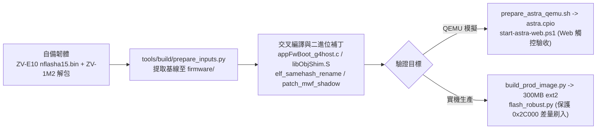

# ZV-E10 ASTRA Port

[English](README.en.md) | [简体中文](README.md) | **繁體中文** | [日本語](README.ja.md)

> 將 **Sony ZV-1M2（Gen 5 ASTRA）** 新版觸控選單 UI 與完整互動體系跨代移植至 **Sony ZV-E10（Gen 4）** 的工程工具鏈、QEMU 模擬環境、建置腳本、方法論與 AI Agent Skills。

<p>
  
  <a href="LICENSE"></a>
  <a href="https://github.com/nolan2628/ZVE10-Astra-Public/stargazers"></a>
  <a href="https://github.com/nolan2628/ZVE10-Astra-Public/issues"></a>
  <a href="https://discord.gg/wdF3y3xCYR"></a>
  <a href="#贊助支持--sponsor"></a>
</p>

> [!CAUTION]
> **僅面向開發者 · 禁止一般使用者刷入（防變磚警示）**
> 本專案目前處於實驗性工程研發階段，**僅面向具備嵌入式 Linux、ARM 逆向、Fastboot/UART 硬體除錯及救磚能力的開發者**。**嚴禁一般使用者直接編譯或向實機刷入韌體**，否則極易因分區基線不符、熔斷計數未重置或誤操作 `WBI1` 磁區導致相機無法開機（變磚）。

> [!WARNING]
> **版權、免責與目前功能邊界聲明（必讀）**
> 1. **零專有韌體分發**：本儲存庫**不包含**任何索尼專有韌體、映像檔、共享函式庫或 UI 資源（`appFw.so`、`libObj.so`、`nflasha15.bin` 等）。重現者需自行從合法擁有的裝置或官方更新檔中提取所需基線檔案至本地 `firmware/` 目錄（已由 `.gitignore` 忽略）。
> 2. **保留載荷說明**：儲存庫僅額外保留非索尼的底層刷機輔助載荷（`tools/flash/stage2.bin`、`tools/flash/stage2_turbo_cmd25.bin`、`tools/flash/hardware/fastboot_zve10.bin`）及開源 `pmca` 元件（詳見 [THIRD_PARTY_NOTICES.md](THIRD_PARTY_NOTICES.md)）。
> 3. **已知未打通能力（FL / VV 風格外觀與自訂 LUT）**：
>    - **風格外觀 / 濾鏡（`FL`、`VV` 等）**：目前底層參數表與管線尚未打通，需開發者自行從其他支援機型提取適配（參考：[751K/sony-look-bridge](https://github.com/751K/sony-look-bridge)）。
>    - **自訂 LUT**：關於 User LUT 支援，需配合 [Erlla/sony-a7m4-custom-firmware](https://github.com/Erlla/sony-a7m4-custom-firmware) 的自訂 LUT 方案進行訓練與生成。
> 4. **刷機前置備份**：實機進行任何寫入操作前，務必完整備份本機原廠 `nflasha15.bin` 與 `nflasha5.bin`，並嚴格遵守 `0x2C000` (`WBI1`) 磁區保護規程。

---

## 成果展示（實機實拍 & QEMU 模擬）

| 實機拍攝主畫面（新觸控 OSD） | 實機新版直向選單 | 實機風格外觀 `FL` 選單（僅 UI，底層見限制說明） |
| :---: | :---: | :---: |
|  |  |  |

**QEMU (`-M zve10`) Web UI 模擬與觸控互動錄影：**


---

## 核心能力

- **跨代執行期墊片（`src/appFwBoot_g4host.c`）**：
  - 獨立 **16MB 專屬堆疊執行緒**載入 `appFw.so`，規避 2,730 個 `.init_array` 建構函式（單幀最高 3.28MB）導致的預設執行緒堆疊溢位與 32-bit VMA 耗盡。
  - **等長同 GNU Hash 符號隔離**（`tools/build/elf_samehash_rename.py` + `manifests/rename_plan.json`）：消除四代與五代 557 個衝突符號（如 `fault=0x234` 崩潰）。
  - **四代硬體底盤復用與交接**：保留四代 `im.elf`、`libObj.so`、`libInfraSKD.so`（明文）、`libInfraLensCommunicator.so` 與 `/sabin/`，透過 `libMWF.so` 影子繼承補丁與 `g4_handoff_real_device` 實現 E 接環鏡頭、觸控（`0x026c`）與硬體顯示記憶體無縫交接。
- **QEMU 軟體光柵模擬與 Web 觸控台（`tools/qemu/`）**：
  - 支援在無實機的情況下透過 QEMU `-M zve10` 執行完整 ZV-1M2 新選單，軟體光柵同步輸出 **640×480 Morton Z-order RGBA4444** 畫面緩衝。
  - 提供基於瀏覽器畫布的即時 Web UI（`astra_web_qemu.py` + `astra_web_ui.html`），支援滑鼠點擊/拖曳觸控、實體按鍵、冷開機模式直達（`menu` / `shooting` / `normal`）與即時序列埠日誌監控。
- **實機 USB 沙盒預檢、差量刷寫與救磚（`tools/flash/`）**：
  - `camtool`（Jiritsu/MSC）線上健康檢查與 `/log/g5/` 零刷機沙盒閉包驗證。
  - `flash_robust.py` 支援斷點續傳與秒級 `--diff-from` 差量刷寫，並於程式碼層級鎖定保護 `0x2C000` (`WBI1`) 磁區。
  - `restore_factory_pure.py` 與 `restore_wbi_auto.py` 提供完整原廠回退與紅燈不亮救磚能力。
- **AI 協作 Skills（`.agents/skills/`）**：
  - 內建 4 套面向 Antigravity / Claude Code / Codex 的標準化 Skill，涵蓋總覽導覽、QEMU 除錯、實機刷寫與跨代逆向方法論。

---

## 系統架構速覽



完整 4 張詳細架構圖請查閱 [docs/architecture.md](docs/architecture.md)，工程原理與四大公理請查閱 [docs/methodology.md](docs/methodology.md)。

---

## 前置依賴與開源上游

| 資源 / 元件 | 來源 / 說明 | 本地放置 / 環境變數約定 |
| :--- | :--- | :--- |
| **ZV-E10 2.03 韌體更新包** | [Sony 官方下載頁面](https://www.sony.com/electronics/support/e-mount-body-zv-e-series/zv-e10/downloads) | 儲存庫根目錄或工作區下的 `Update_ZVE10V203.dmg` |
| **Sony Linux 原始碼** | [linux-kernel.tar.gz](https://prodgpl.blob.core.windows.net/download/DI/ZV-E10_Ver.2.02/linux-kernel.tar.gz) | `work/linux-kernel.tar.gz` |
| **QEMU 11.1.2 原始碼** | [qemu-11.1.2.tar.xz](https://download.qemu.org/qemu-11.1.2.tar.xz) | `work/qemu-11.1.2.tar.xz` |
| **ARM 交叉工具鏈** | [Bootlin armv7-eabihf，2020.08-1](https://toolchains.bootlin.com/downloads/releases/toolchains/armv7-eabihf/tarballs/armv7-eabihf--glibc--stable-2020.08-1.tar.bz2) | `work/armv7-toolchain.tar.bz2` |
| **前置開源研究儲存庫** | [chocotan/zve10-qemu](https://github.com/chocotan/zve10-qemu)<br>[chocotan/a7c2-qemu](https://github.com/chocotan/a7c2-qemu)<br>[DavidBuchanan314/ILCE-7M4-RE](https://github.com/DavidBuchanan314/ILCE-7M4-RE)<br>[erlla/sony-a7m4-custom-firmware](https://github.com/erlla/sony-a7m4-custom-firmware)<br>[751K/sony-look-bridge](https://github.com/751K/sony-look-bridge) | 用於搭建 `-M zve10` QEMU 機器模型、韌體解包、自訂 LUT 訓練與風格外觀（`FL`/`VV`）提取適配 |
| **USB 除錯與 Camtool 工具鏈** | [nolan2628/Sony-ZVE-10-Camtool](https://github.com/nolan2628/Sony-ZVE-10-Camtool) | 實機 USB Jiritsu/MSC 通訊、線上除錯與補丁套件上游（內建於 `tools/flash/camtool/`） |
| **Fastboot 與硬體刷寫工具鏈** | [dino2048/zv-e10-toolkit](https://github.com/dino2048/zv-e10-toolkit) | 索尼相機 Fastboot 協定與刷寫架構上游：`stage1.bin` + `stage2-flash.bin` 1 MiB Sparse 分片刷寫、Darwin `0x16` 硬體看門狗保活長會話，與 Windows `libusb-package` 原生直連（內建於 `tools/flash/toolkit_fastboot/`） |
| **Python & Zig 工具鏈** | [`uv`](https://docs.astral.sh/uv/)（自動按需拉取 `ziglang`、`pyelftools`、`pyusb` 等） | 宿主機安裝 `uv` 與 WSL2（用於 `e2fsck`/`debugfs`/QEMU） |

---

## 快速開始（重現流程）

### Step 1：準備韌體輸入

按照 [docs/firmware-extraction.md](docs/firmware-extraction.md) 從個人備份/官方更新包提取基線後執行：

```powershell
uv run python tools/build/prepare_inputs.py `
  --gen4-image firmware/backup/nflasha15.bin `
  --gen5-root <你的_ZV1M2_解包根目錄>
```

### Step 2：建置補丁庫與跨代引導墊片

```powershell
# 1. 四代宿主前置處理（im.elf 後台接力補丁 + libMWF 影子繼承 + libIMDB 裁剪）
uv run python tools/build/patch_im_elf.py
uv run python tools/build/patch_mwf_shadow.py
uv run python tools/build/patch_libobj.py
uv run python tools/build/generate_hybrid_imdb.py --variant dump

# 2. 五代函式庫 SONAME 改寫與等長同 Hash 符號重新命名
uv run python tools/build/p2_patch_soname.py
uv run python tools/build/batch_rename_g5.py

# 3. 交叉編譯樁庫與跨代引導墊片 (e_flags=0x05000002, GLIBC<=2.4)
uv run --with ziglang python tools/build/build_libobjshim.py
uv run --with ziglang --with pyelftools python tools/build/build_appfwboot.py --target all
```

### Step 3A：在 QEMU Web UI 中驗證新選單與觸控

確認已參照 [docs/qemu-prerequisites.md](docs/qemu-prerequisites.md) 準備好 `-M zve10` QEMU、核心與基礎 `initramfs-ui`（預設位於 `~/zve10-qemu/work`，可透過 `ZVE10_QEMU_WORK` 覆蓋）：

```powershell
wsl -e bash tools/qemu/prepare_astra_qemu.sh
.\tools\qemu\start-astra-web.ps1 -Port 8765 -OpenBrowser
```

### Step 3B：建置實機生產映像檔並安全刷入

請先閱讀完整安全規程 [docs/hardware-flashing-and-recovery.md](docs/hardware-flashing-and-recovery.md)：

```powershell
uv run python tools/build/build_prod_image.py --output build_out/nflasha15_astra_prod.bin
uv run python tools/build/verify_prod_image.py --image build_out/nflasha15_astra_prod.bin

uv run python tools/flash/check_image.py
uv run python tools/flash/flash_robust.py `
  --image build_out/nflasha15_astra_prod.bin `
  --diff-from firmware/backup/nflasha15.bin `
  --flash
```

---

## 文件與 AI Skills 索引

- **架構與方法論文件** *(目前提供簡體中文版本)*：
  - [docs/architecture.md](docs/architecture.md) —— 4 張系統架構圖與核心元件對映
  - [docs/methodology.md](docs/methodology.md) —— 跨代移植四大工程公理與逆向方法論
  - [docs/firmware-extraction.md](docs/firmware-extraction.md) —— 韌體提取與基線校驗教學
  - [docs/qemu-prerequisites.md](docs/qemu-prerequisites.md) —— QEMU `-M zve10` 與核心搭建指南
  - [docs/hardware-flashing-and-recovery.md](docs/hardware-flashing-and-recovery.md) —— 硬體注入、USB 沙盒、差量刷機與救磚指南
- **內建 Project Skills（`.agents/skills/`）**：
  - [`zve10-astra-overview`](.agents/skills/zve10-astra-overview/SKILL.md)
  - [`zve10-astra-qemu`](.agents/skills/zve10-astra-qemu/SKILL.md)
  - [`zve10-astra-porting`](.agents/skills/zve10-astra-porting/SKILL.md)
  - [`zve10-astra-methodology`](.agents/skills/zve10-astra-methodology/SKILL.md)

---

## 開發者交流 / Community

歡迎對索尼相機逆向、QEMU 模擬與跨代移植感興趣的開發者加入 Discord 頻道交流除錯經驗（**註：本群僅面向開發者技術討論，不提供一鍵刷機包或代刷服務，入群前請務必閱讀上方安全紅線**）：

<p>
  <a href="https://discord.gg/wdF3y3xCYR"></a>
</p>

---

## 贊助支持 / Sponsor

如果本專案對你展開索尼相機韌體逆向或跨代移植研究有所幫助，歡迎透過微信或支付寶掃碼贊助支持——**希望多多贊助 token 費用**，用於持續推進 AI 輔助逆向分析、工程開發與設備測試開銷：

| 微信支付 (WeChat Pay) | 支付寶 (Alipay) |
| :---: | :---: |
|  |  |

---

## License

本儲存庫中的全部程式碼、腳本與原創文件均採用 **[GNU General Public License v3.0 (GPLv3)](LICENSE)** 開源。任何借鑑、修改或二次分發本專案程式碼之衍生作品，均須保留原版權與出處署名（參見 [CITATION.cff](CITATION.cff)）並以相同 GPLv3 授權條款開源；第三方元件聲明見 [THIRD_PARTY_NOTICES.md](THIRD_PARTY_NOTICES.md)。
